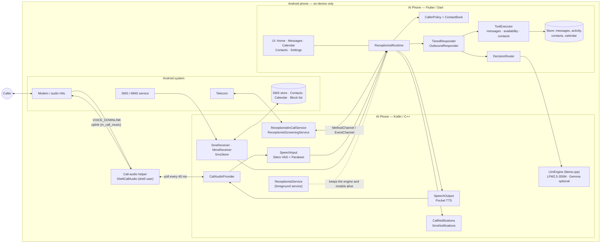
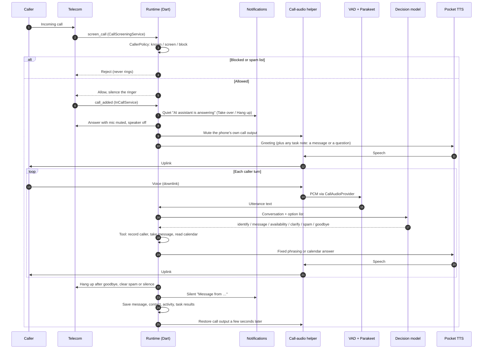
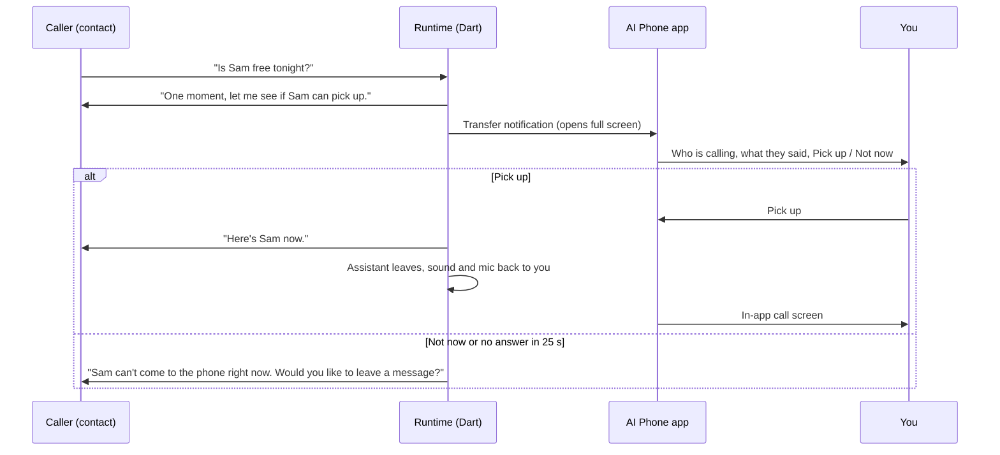
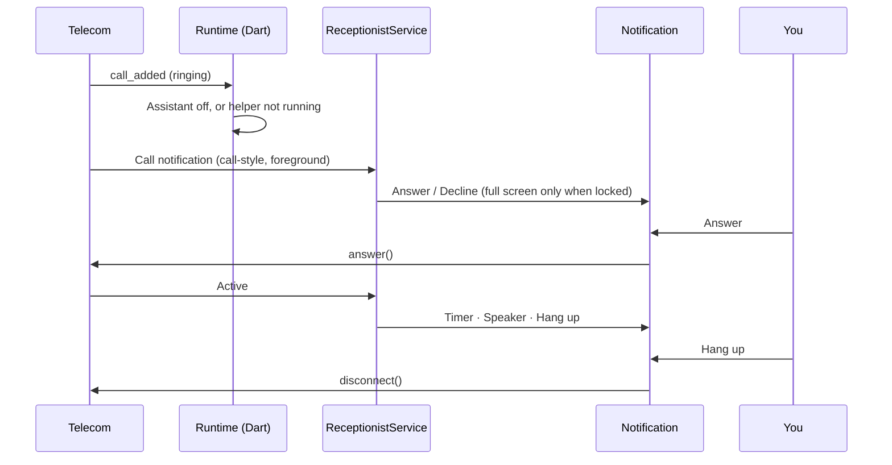
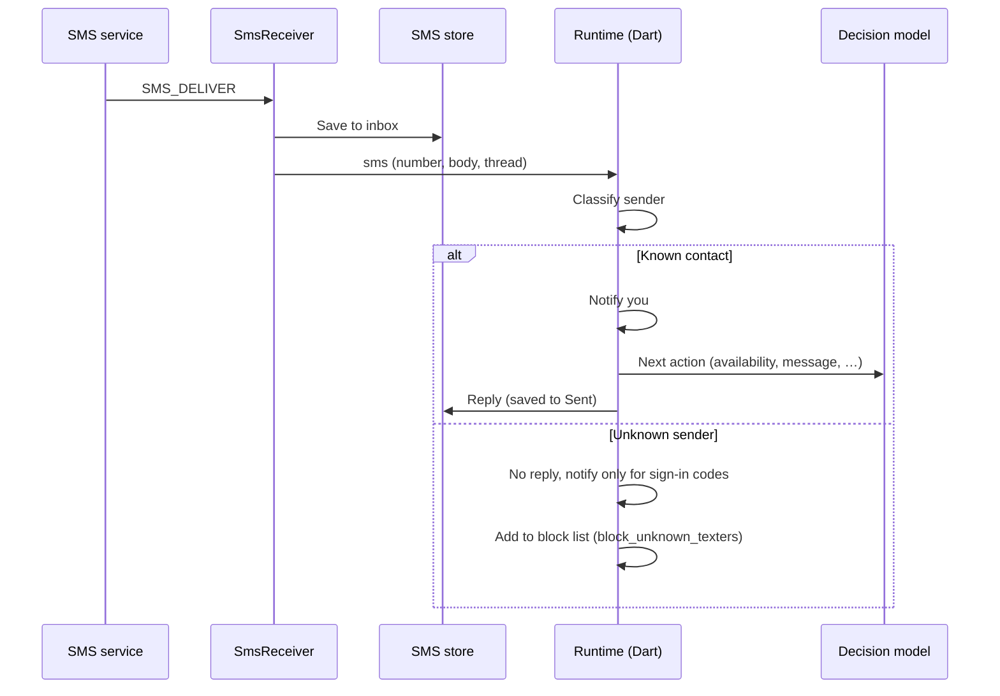
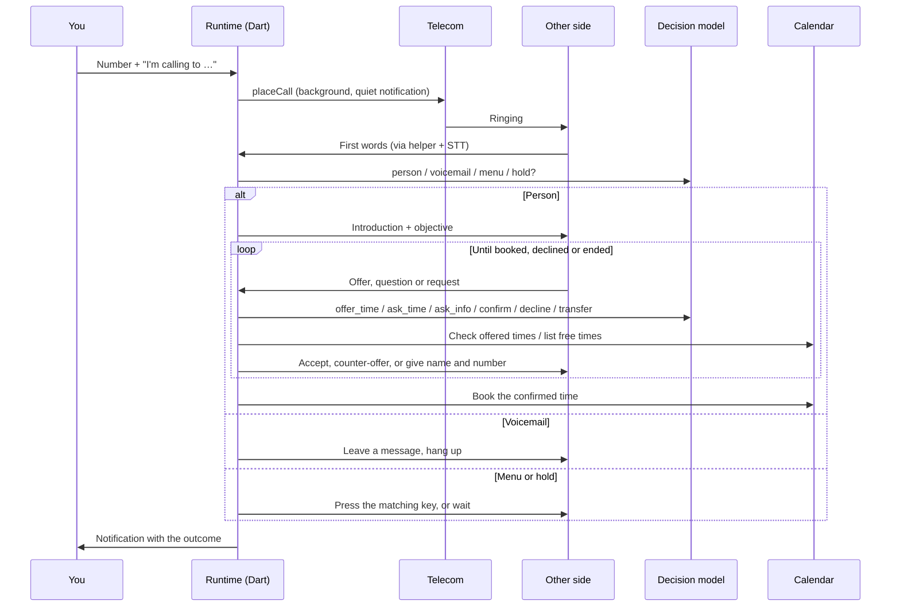

# AI Phone

An on-device AI receptionist for an Android phone. It answers calls and texts
for you, screens unknown callers, hangs up on scammers, takes messages, answers
"are you free?" from your calendar, and can place calls for you to book or
coordinate something. **Everything runs on the phone**: the release app has no
INTERNET permission, and there is no server or cloud inference.

| Layer | Implementation |
| --- | --- |
| Conversation decisions | Fine-tuned **LFM2.5-350M** (GGUF) through a pinned llama.cpp; Gemma 4 E2B optional |
| Speech to text | Silero VAD + NVIDIA **Parakeet** TDT 0.6B v3 (int8) through sherpa-onnx |
| Topic detection | **bge-small-en-v1.5** sentence embeddings (GGUF, 33M parameters) through llama.cpp, ~10–50 ms per sentence |
| Text to speech | Pocket TTS, streamed sentence by sentence |
| Call audio | A shell-user helper that reads the call downlink and plays into the uplink |
| Telephony | Default phone app (`InCallService`), `CallScreeningService`, default messaging app |
| App and agent logic | Flutter / Dart: policy, workflows, tools, contact memory, UI |

## What it does

### Calls

| Caller | What happens |
| --- | --- |
| On the block list or known spam | Rejected before the phone rings. |
| Known contact (contact book or phone address book) | The assistant answers: "Hi {name}, you've reached {owner}'s AI Assistant. How can I help?" Once they say what they want it offers a **warm transfer** to you, then answers availability from your calendar and takes messages. |
| Unknown caller | The assistant answers and asks who is calling and what it is about (up to two follow-ups), then takes a message in the caller's own words. |
| Scam or sales call | Hung up on only with clear signs: selling something, asking for money or payment, or asking the assistant to do something (press a key, read a code, confirm details). It takes two red flags, or the decision model's spam verdict plus one. The number is blocked and a silent "Blocked a spam call" notification shows, e.g. "Spam: Scam · …". A spam *topic* match alone is only a label ("Spam: Scam · …"), never a hang-up. Anything else becomes a message. |
| Assistant off, or call-audio helper not running | The call rings through to you as a notification with **Answer** / **Decline**. |

While the assistant handles a call **nothing plays through the phone**: no
ringing, speakerphone off, the phone's microphone muted (on phones where a
muted call also silences the assistant, such as Samsung, it opens only while
the assistant's speech or hold music is playing; set `call_audio.mic_mute` to
`always`, `while_silent` or `auto`), and the call-audio helper sets the audio policy's in-call volume to 0 on the earpiece, speaker
and headsets (restored a few seconds after the call, so the end-of-call tone
is silent too). Only a quiet "AI assistant is answering" notification shows,
with **Take over** and **Hang up**. The assistant hangs up itself after a
goodbye, after spam, or when the line goes quiet (on calls it answers it asks
"Are you still there?" after 8 s and says goodbye 10 s later; 30 s on calls it
places; never while on hold).

The line is never left dead: if the caller talks over the assistant and it was
only noise or "okay" / "mm-hmm", the assistant finishes its sentence; speech it
could not make out gets "Sorry, I didn't catch that"; and a caller waiting for
a warm transfer hears soft hold music, generated on the phone, with "Still
trying {owner}. Thanks for holding." every 12 s. Results such as a message left for
you arrive as **silent** notifications and on Home; only urgent alerts sound.
A caller who leaves a message becomes a contact: **known** if they are in your
phone's address book, otherwise named and **screened**.

**Warm transfer (screened).** When someone in your contacts calls (or anyone
you set a transfer task for), the assistant screens the call first: it keeps
asking (up to three times) until the caller gives a useful, valid reason, at
least two real topic words such as "dinner plans tonight", or an emergency.
"Can I talk to him?", "it's personal" or "about something" do not count. With
a reason it says "One moment, let me see if {owner} can pick up," and the app
opens full screen with who is calling and everything they said, plus
**Pick up** / **Not now**. Without one you are not interrupted and a message
is taken. Pick up gives you the call with sound and your
microphone back; Not now, or no answer within `transfer_wait_seconds` (25 s),
and the assistant says you can't come to the phone and takes a message.

**Two calls at once.** The assistant holds one conversation at a time and never
answers over a call in progress (yours or its own), since answering would put
that call on hold. A second call rings as call waiting with **Answer** /
**Decline**; if it is still ringing when the line frees up, the assistant
answers it. If you answer it while the assistant is talking to someone, the
assistant stops, that caller is put on hold and becomes yours ("… is on hold"
notification; **Resume** or **Hang up** from the call). The call notification
always shows the call that needs you most: a ringing call first, then your
active, dialing and held calls, then the assistant's.

Your own calls are notifications too: ringing calls get Android's call-style
**Answer** / **Decline**, calls in progress show a timer with **Speaker** and
**Hang up**. The app's call screen opens only when you tap the notification or
dial from inside the app. A full-screen call screen appears only on the lock
screen, as with any phone app.

### Texts

AI Phone can be the default messaging app (conversations, replies, pictures).

* Known contacts get a short reply from the assistant.
* Anyone else gets no reply and no notification while the assistant is on; with
  `block_unknown_texters` (default on) the sender is added to the system block
  list. One-time sign-in codes always notify and are never blocked.
* With the assistant off, every text notifies like a normal messaging app.
* Picture and group messages are received and shown; the assistant never
  answers group messages.

### Call for me

The **Call** button → **Call for me**: give a number (or a contact) and finish
"I'm calling to …" (e.g. "book a haircut on Friday afternoon"). The assistant
places the call in the background and handles what answers:

| On the line | What the assistant does |
| --- | --- |
| A person | Introduces itself as your AI assistant and states the objective |
| Voicemail | Leaves a short message with the objective and hangs up |
| Phone menu | Presses the option that matches the objective |
| Hold | Waits silently, up to the hold limit |
| A scheduler | Checks every offered time against your calendar, offers your free times, gives your name and number, and books the confirmed time into the Calendar |
| No time fits | After three offers that do not fit, says you will call back |
| The wrong person | Asks to be transferred |

### Topics and intents

Every caller sentence is embedded on the phone and compared with example
phrases for configurable topics (Settings → Topics and intents). Each topic is
a **valid reason** (Plans, Family, Work, Appointment, Delivery, Billing,
Urgent, …), **not a reason** ("can I talk to him", "it's personal") or
**spam** (sales, money requests). The best match above the threshold (0.70 by
default) decides whether a caller has given a reason for a warm transfer;
without a match the word rule decides. The detected topic is shown on Home,
in call details, on the transfer screen and in the call, transfer and message
notifications. The settings page has a "Try a sentence" box that shows the top
matches and scores for tuning topics and the threshold.

Measured on the phone: "Is he free for lunch on Saturday" → Plans 0.89;
"Your order is out for delivery today" → Delivery 0.86; "Can you put me through
to him" → not a reason 0.87; "You qualify for a lower credit card rate" →
Sales 0.90; "How is the weather over there" → no topic.

**Spam detection, measured on the phone** (106 labelled caller turns):
decision model + red-flag keywords hang up on 38 of 40 scams and on none of
the 66 legitimate callers. Adding a spam-topic match as a red flag caught 39 of
40 but hung up on 2 legitimate callers, so topics only label calls. The topic
detector alone recognises 22 of 40 scams as spam and wrongly flags 2 of 66.

### Tasks

The **Tasks** tab (also on each contact) holds work for the assistant:

* **When they call** — for a person or number, the next time they call the
  assistant **tells them** your message in its greeting, **asks them** your
  question and saves their answer for you, or **transfers them** to you.
  Tasks are marked done with the result.
* **When anyone calls about a topic** — standing tasks for a detected topic
  (e.g. anyone about Delivery: "leave it at the side door"; anyone about
  Urgent: transfer to me).
* **Calls to make** — "Call for me" tasks and their outcomes.

### Contacts, calendar and the app

* **Contacts** build themselves: every caller or texter gets an entry
  (known, screened, unknown or blocked) with the name and reason they gave,
  facts the assistant learned, and a history of calls and texts.
* **Calendar** (Settings → Calendar and availability): weekly working hours plus your own items. Callers only hear
  "busy" unless an item is marked to share details; phone-calendar events count
  as busy and stay private.
* **Screens**: **Home** (every call and text, incoming and outgoing — yours
  and the assistant's — filed into All, Important, Not important, Spam and
  Blocked), **Messages**, **Tasks**, **Contacts**, **Settings** (setup,
  calendar, test mode, wording, models, activity log, advanced JSON
  configuration), and the **Call** button (Call for me / Call someone / Dial
  pad).
* **Contact search**: calling someone, starting a text, "Call for me" and new
  tasks all open one search over your contacts and the phone's address book,
  by name or number. A number that matches nobody can be used as is or added
  as a contact.
* **Blocking**: every incoming call or text on Home has **Block number** (with
  confirmation) in its details; blocked numbers show **Unblock number**.

## Architecture

### System diagram



The Flutter engine lives in the foreground service, so calls and texts are
handled with the app closed; the UI attaches to the same engine when opened.

### Incoming call answered by the assistant



### Warm transfer



### Call that rings through to you



### Incoming text



### Call for me



### Code map

| Path | Responsibility |
| --- | --- |
| `lib/src/runtime.dart` | Event hub: calls, texts, call-outs, models, notifications |
| `lib/src/policy.dart`, `contacts.dart` | Who is known, screened or blocked; the self-building contact book |
| `lib/src/tiered.dart` | Inbound conversation flow with the decision model; spam rules |
| `lib/src/outbound.dart` | Call-for-me flow: line detection, menus, scheduling, booking |
| `lib/src/decision.dart` | Decision prompts, option sets and slot extraction |
| `lib/src/voice_session.dart` | One spoken conversation: listening, speaking, barge-in, hang-up |
| `lib/src/tools.dart`, `calendar.dart` | Messages, availability, free windows, day and time parsing |
| `lib/src/agent.dart`, `reply.dart` | Optional Gemma responder with grammar-constrained tool calls |
| `lib/src/texting.dart`, `call_summary.dart` | Messaging store access; Home events and categories |
| `lib/src/tasks.dart` | Tasks for the next call from a person, or for anyone about a topic |
| `lib/src/intents.dart` | Topic/intent definitions and embedding-based detection |
| `lib/src/store.dart`, `config.dart` | App-private storage and configuration |
| `lib/src/ui/` | Screens |
| `android/.../telephony/` | Call services, call registry, call notifications, call-audio bridge |
| `android/.../sms/` | SMS/MMS receive, send, store, notifications, MMS PDU reader |
| `android/.../engine/` | llama.cpp (decision model, embeddings), Parakeet/VAD and Pocket TTS engines |
| `android/.../shell/ShellCallAudio.kt` | Call-audio helper (runs as the shell user) |
| `native/` | JNI for llama.cpp and Pocket TTS |
| `tool/` | Native setup, model provisioning, helper start, Vapi tests, fine-tuning |

## Phone-call audio on a non-rooted phone

Android gives ordinary apps no access to the cellular voice stream. Measured on
an Android 16 phone (Snapdragon, not rooted) with real calls:

| Approach | Result |
| --- | --- |
| Speakerphone + app microphone | Every microphone source is silenced or zero-filled during a call. Not used. |
| `Call.enterBackgroundAudioProcessing()` | Hidden system API; the HAL feeds only zeros. Not used. |
| **Shell-user helper, normally answered call** | **Works.** `VOICE_DOWNLINK` delivers the caller digitally; 48 kHz `voice_communication` audio routed to `telephony_tx` (`in_call_music`) reaches the caller. |

The helper (`ShellCallAudio`, inside the APK) runs as the adb shell user, which
holds `CAPTURE_AUDIO_OUTPUT`, `CALL_AUDIO_INTERCEPTION` and
`MODIFY_AUDIO_ROUTING`. SELinux forbids sockets between the shell user and
apps, so the helper polls a shell-only `ContentProvider` every 40 ms; each
exchange carries caller audio in and speech out. Because the downlink never
contains the assistant's own voice, callers can interrupt it (barge-in).

Start the helper once per boot or app update (it also starts the app's
background service, which some phones do not restart after an update):

```bash
tool/start_call_audio_helper.sh <android-serial>
```

Without it, calls ring through to you. Shizuku or root could start the helper
without a computer; that is not implemented.

Some phones (seen on Samsung) confine an app with nothing on screen to a few
efficiency cores, where speech renders at under half real time and callers
hear long gaps. During its calls the assistant therefore keeps an invisible,
untouchable 1×1 overlay window, which moves it to the full-CPU foreground
group; this needs **Display over other apps** (Setup → Full speed during
calls, or `adb shell appops set ai.local.receptionist SYSTEM_ALERT_WINDOW
allow`).

## Decision model

By default (`"responder": "small_model"`) every call and text turn is decided
by the fine-tuned **LFM2.5-350M** (`receptionist-decision-v2-350m-q8_0.gguf`);
Gemma is never loaded and the app uses about 3 GB with Parakeet 0.6B. The model
reads the last few lines of the conversation and picks the next action;
replies are fixed phrasings, and availability comes straight from the
calendar. Anything it is unsure about becomes "take a message".

| Evaluation (held-out, on the phone) | Result |
| --- | --- |
| v1, single turns (`test/fixtures/decision_eval.jsonl`) | 98% accuracy, 0.07 s per decision (zero-shot: 25%; Gemma 4 E2B: 83%, 2.2 s) |
| v2, inbound conversations (`decision_eval_v2.jsonl`) | 77% accuracy; 38 of 40 scams hung up on; 0 wrongful hang-ups; ~0.1 s |
| v2, call-for-me (`outbound_eval.jsonl`) | 30 of 30 with the outbound rules |

`"responder": "tiered"` escalates uncertain turns to Gemma; `"gemma"` uses
Gemma for everything. Gemma can also restyle the fixed phrasings once
(Settings → Assistant wording).

Rebuild (on the computer; training data comes from a local Ollama model):

```bash
python3 -I tool/finetune/generate_data.py --out <v1>          # single caller turns
python3 -I tool/finetune/generate_dialogues.py --out <dlg>    # multi-turn inbound scenarios (scenarios.py)
python3 -I tool/finetune/generate_outbound.py --out <obd>     # call-for-me dialogues
python3 -I tool/finetune/merge_v2.py --v1 <v1> --dialogues <dlg> --outbound <obd> --out <data>
<venv>/bin/python tool/finetune/train.py --data <data> --out <dir> --llama-cpp <pinned llama.cpp>
python3 -B tool/provision_models.py --device <android-serial> --decision <dir>/receptionist-decision-v2-350m-q8_0.gguf
```

LFM models use the LFM Open License v1.0 (free below USD 10M annual revenue).

## Build and install

Requirements: Flutter 3.47.x, Android SDK with NDK 28.2.13676358 and CMake
3.22.1, an arm64 phone with ARMv8.2 dot-product/FP16, and about 4 GB free.

```bash
python3 -B tool/setup_native.py            # pinned llama.cpp + sherpa-onnx libraries (computer only)
flutter pub get
flutter build apk --debug --target-platform android-arm64
adb -s <android-serial> install -r build/app/outputs/flutter-apk/app-debug.apk
python3 -B tool/provision_models.py --device <android-serial> --audio <audio-models> \
    --stt parakeet-0.6b=<parakeet-dir> --decision <receptionist-decision-v2-350m-q8_0.gguf> \
    --embedding <bge-small-en-v1.5-q8_0.gguf>
tool/start_call_audio_helper.sh <android-serial>
```

`--audio` points at a folder with `vad/silero_vad.onnx` and `pocket/`. Models
stream into app-private storage through `run-as`, so provisioning needs the
debug build. Then open **Settings → Setup and permissions**: permissions,
default phone app, default messaging app, call screening, the call-audio helper,
background operation and full speed during calls.

Phones with aggressive battery managers may also need:

```bash
adb shell cmd appops set ai.local.receptionist RUN_ANY_IN_BACKGROUND allow
adb shell am set-standby-bucket ai.local.receptionist active
adb shell cmd deviceidle whitelist +ai.local.receptionist
```

To give messaging back to Google Messages:
`adb shell cmd role add-role-holder android.app.role.SMS com.google.android.apps.messaging`.

## Configuration

Settings → Advanced configuration edits the whole configuration (JSON); see
[`config/receptionist.example.json`](config/receptionist.example.json).
Workflows (`known`, `screen`) set the greeting, instructions and enabled tools
(`take_message`, `check_availability`, `record_caller`, `remember`,
`mark_spam`, `notify_owner`, `end_conversation`, plus `custom_tools`).
Placeholders: `{owner_name}`, `{assistant_name}`, `{caller_name}`,
`{caller_first_name}`, `{caller_details}`, `{number}`.

## Testing

```bash
flutter analyze
flutter test
(cd android && ./gradlew :app:testDebugUnitTest)   # Kotlin unit tests (MMS PDU reader)
```

* **Settings → Test the assistant**: talk to it through the phone's speaker
  (no call is placed) or simulate a text.
* **Real calls**: `tool/vapi_test_call.py` calls the phone from a Vapi assistant
  that plays the caller (`known`, `screen`, `spam`, `probe*`) and saves Vapi's
  transcript. Vapi is only a computer-side harness; the key comes from the
  git-ignored `.env` and the destination number from a private file:

  ```bash
  python3 -B tool/vapi_test_call.py --scenario screen --phone-number-id <vapi-number-id> \
      --to-file <private-file-with-phone-number> --output <private-dir>
  ```

* **Debug builds** accept shell-only automation commands, for example:

  ```bash
  adb shell am broadcast -a ai.local.receptionist.DEBUG -p ai.local.receptionist \
      --es command sms --es number +15555550123 --es body "'Is Sam free Monday?'"
  ```

## Limitations

* The call-audio helper must be started from a computer after each reboot or
  app update.
* Sending pictures and group texts is not supported; RCS chats need Google
  Messages.
* Silencing the phone's own call output relies on the call-audio helper; if it
  is not running the assistant does not take calls at all (they ring through).
* Tasks and warm transfer apply to calls, not texts.

## Privacy

Transcripts, messages, contacts and the calendar stay in app-private storage;
release builds never log transcript text and backups are disabled. Personal
test values (phone numbers, Vapi IDs, reports) live outside the repository or in
the ignored `private/` folder.

## Icon

`tool/icon/icon.svg` is the source for the launcher icon (a white handset over
a rotary finger-hole dial, on black); the vector layers in
`res/drawable/ic_launcher_*` and the legacy PNGs are generated from it.
